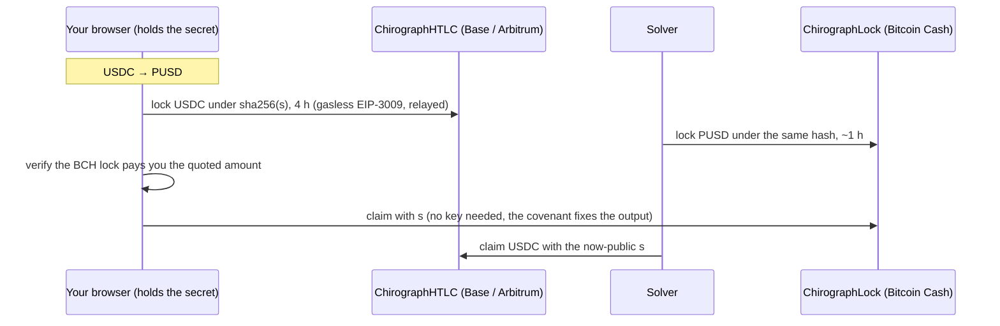

# Chirograph

**Move $2 from USDC on Base to PUSD on Bitcoin Cash for 1¢, in about three seconds. The usual route costs about 23¢ and needs a second swap.**

A café in Manila takes Bitcoin Cash through Paytaca. A visitor holds USDC on Base. Today the visitor
would have to sign up at an exchange or run a multi-hop route. With Chirograph they sign once, and the
café sees PUSD a few seconds later.

Chirograph swaps USDC on Base or Arbitrum for PUSD (ParyonUSD) on Bitcoin Cash, and back. Nothing is
bridged or wrapped. The USDC stays on its chain and the PUSD stays on Bitcoin Cash. Both sides lock to the
same 32-byte secret, and only your browser knows it. Revealing the secret to collect one side is exactly
what lets the other side collect theirs. If anything stalls, both sides refund themselves.

**Live on mainnet:** https://chirograph-cash.vercel.app
- [Swap](https://chirograph-cash.vercel.app/swap) · [live explorer of every swap](https://chirograph-cash.vercel.app/explorer) · ["Pay with USDC" checkout for Bitcoin Cash merchants](https://chirograph-cash.vercel.app/merchants) · [deck](https://chirograph-cash.vercel.app/deck/)
- Reviewing? Start with [JUDGES.md](JUDGES.md). Every claim and its evidence tier are in [CLAIMS.md](CLAIMS.md). Every transaction is in [PROOF.md](PROOF.md).
- Protocol, timeouts and threat model: [docs/PROTOCOL.md](docs/PROTOCOL.md)

## Mainnet, measured

<!-- summary:start -->
| Direction | Median time to funds | Best | Fully settled (median) | Signatures | Fee |
|---|---|---|---|---|---|
| USDC → PUSD | **3.4 s** | 2.3 s | 6.7 s | 1 | 0.3%, min 1¢ |
| PUSD → USDC | **9.3 s** | 8.2 s | 12.9 s | 1 | 0.3%, min 1¢ |
<!-- summary:end -->

Every number above comes from `proof/mainnet.json` through `pnpm render:proof`. Nothing is typed by
hand. `pnpm verify:onchain` checks each swap against public nodes on all three chains. It confirms that
the secret revealed on Bitcoin Cash is byte for byte the one revealed on the EVM side, and it includes a
negative control that must fail.

For comparison, the route people use today is THORChain plus a Cauldron swap. For $2 it quotes about
**30 s** with three signatures and about 11.6% in fees for USDC → PUSD. For PUSD → USDC it quotes about
**10 minutes**, because it waits for a Bitcoin Cash block, and about 11% in fees. These figures come from
THORChain's quote API (`total_swap_seconds`, `fees.total_bps`). They are labelled MODELED in
[CLAIMS.md](CLAIMS.md).

On 20 November 2026 even that route was closed. THORChain had trading on Base halted
(`HALTBASETRADING=1`; see the [snapshot](proof/thorchain-status-2026-11-20.json)), and it does not
support Arbitrum. Chirograph has no shared bridge or pool that can halt: each swap is two locks and one
secret.

<!-- swaps:start -->
| # | When (UTC) | Swap | Chain | In → out | To funds | Settled | Transactions, in order |
|---|---|---|---|---|---|---|---|
| 1 | 2026-11-20 07:39 | USDC → PUSD | Base | $0.50 → $0.49 | 2.3 s | 6.2 s | [0xf96ca92f…](https://basescan.org/tx/0xf96ca92f0fe1b26100108e1ec549b291c2e2c147d4b2d39496dd1b57bc93dfe3) → [65a581c8…](https://explorer.selene.cash/tx/65a581c87a344245f2effaedc3875cf90d60afca8e6a90418ce270b04095008a) → [184e8ac4…](https://explorer.selene.cash/tx/184e8ac4262c080344878f8c16de8f8b4dff0d389b7386b7f2296e9768190268) → [0xc65a7775…](https://basescan.org/tx/0xc65a777502575013053383908fad99cce6fd67d571f7cb0423355ebc7d8e642b) |
| 2 | 2026-11-20 07:39 | PUSD → USDC | Base | $0.49 → $0.48 | 9.3 s | 12.2 s | [d56788c0…](https://explorer.selene.cash/tx/d56788c0dd9bda641e52be2bd477dfa34113ab4565c56f91515b216d2e72e043) → [0x809cb01c…](https://basescan.org/tx/0x809cb01c7487bf568f1903e665fc5fc4a0d535f9cc6bb7514bb3c08f2cb9b11e) → [0x48b35ff8…](https://basescan.org/tx/0x48b35ff86d13cf308cb3ee2800fccb920dc629d1d2ba11ed238fb78bb57cbd21) → [e5a53442…](https://explorer.selene.cash/tx/e5a53442006e741a11d4a54e9cb41b13bd499376c7af1738a018f1f9e214f8ae) |
| 3 | 2026-11-20 07:41 | USDC → PUSD | Base | $0.45 → $0.44 | 4.4 s | 6.7 s | [0x662497ff…](https://basescan.org/tx/0x662497ffedff9e3d5ca26381e52cbf3166ed31190a41c02b7bf2ffe8a03cd3c3) → [3ff37605…](https://explorer.selene.cash/tx/3ff376054de430566cb617e01fd0d7caaf01c94c1d2e7088f25dd22c9b8f7700) → [20030fd7…](https://explorer.selene.cash/tx/20030fd77455e5bbe311a382e435b9fc1db98d9dd7b8515e8aa822a35dff44fd) → [0x113a4c38…](https://basescan.org/tx/0x113a4c38f52c21f838c13c38305eb6c72cec27abb1bc83b2ceb9e729c8d7125a) |
| 4 | 2026-11-20 07:41 | PUSD → USDC | Arbitrum | $0.30 → $0.29 | 10.4 s | 12.9 s | [94bdfc81…](https://explorer.selene.cash/tx/94bdfc81c8f88d43c251b948be77487828a4a9fe869c94063cc5e50c9a0147fc) → [0xf769f1e6…](https://arbiscan.io/tx/0xf769f1e6cd052b062d48b47c8c11c02d0e6f65e3a87830f85efd4cc18790c43e) → [0xac5cf924…](https://arbiscan.io/tx/0xac5cf924ecc21d707a9d0b1fa26ad060102c401751281d3c6372623effb56feb) → [a896b9f1…](https://explorer.selene.cash/tx/a896b9f13853c9ef31b7b36764af1be058b9f04167fb766c328d2a143e0258bc) |
| 5 | 2026-11-20 07:44 | USDC → PUSD | Arbitrum | $0.28 → $0.27 | 3.4 s | 6.8 s | [0x3631b66b…](https://arbiscan.io/tx/0x3631b66bcd0e98ea555d73f71086063bbfc66f40807dfffdfe8af1bbdc120e2f) → [b0787eda…](https://explorer.selene.cash/tx/b0787eda7a9dc4da177299fa7f04e60a12df56571830187c140d7bf4f5b9ed6b) → [a0b48c9c…](https://explorer.selene.cash/tx/a0b48c9c090033df9cf11fffb9c699a133d9c5109fbc0e6b894d803d42fd29a9) → [0x689e0dd7…](https://arbiscan.io/tx/0x689e0dd7d3cb3ce574d434fe27f483541d9f746462ff9a363ea837361faa259f) |
| 6 | 2026-11-20 07:44 | PUSD → USDC | Base | $0.27 → $0.26 | 8.2 s | 14 s | [b5a7fa30…](https://explorer.selene.cash/tx/b5a7fa30831f83408c15c22d0789fb49e3207356ffff2cf33d4fc20e5f04d3bd) → [0x928e61df…](https://basescan.org/tx/0x928e61dfe584f18b161bea22b9fae03234d466e0110b8ec3a3a8f2d257d81dd3) → [0x405aa9a1…](https://basescan.org/tx/0x405aa9a1184c0528dc31170d301aefa83e51ea59075ec2e9866f42bab32fe355) → [084b5149…](https://explorer.selene.cash/tx/084b514921a3c51a956ae166bf86086c686bc4b1285220e7ce9f06d60564b6b6) |
<!-- swaps:end -->

## How it works

1. Your browser draws a 32-byte secret and takes its SHA-256 hash.
2. You lock your side under that hash with one signature. For USDC that is an EIP-3009 authorization:
   it costs you no gas, because the relayer submits it. For PUSD it is a transaction signed in your
   wallet over WizardConnect.
3. The solver locks its side under the same hash, with a shorter timeout.
4. Your browser checks that lock on-chain: your address, your quoted amount, your hash and a safe timeout.
   Only then does it reveal the secret to collect.
5. The solver reuses the now-public secret to collect your side. Done.



### Bitcoin Cash: `ChirographLock`, a 72-byte keyless covenant

[`contracts/bch/src/ChirographLock.cash`](contracts/bch/src/ChirographLock.cash) uses CashScript 0.14
and P2SH32. Claim and refund need no signature at all. The covenant reads its own transaction:
`tx.outputs[this.activeInputIndex]` must pay the pre-agreed locking bytecode, with the same token
category, the same token amount, the same NFT commitment, and at most a capped miner fee. Anyone (the
user, the solver, a watchtower) can therefore broadcast a claim or a refund, and nobody can redirect it.
Because each input checks the output at its own index, many locks can settle in one transaction.

- It uses the May 2026 upgrade: the shared output check is a function compiled to `OP_DEFINE` /
  `OP_INVOKE`. CashTokens carry PUSD (category `2469acc5…2544`). Refunds use `tx.time` against
  median time past, and the timeouts allow for its lag of about an hour.
- Fast settlement is built on 0-conf with double-spend proofs. The solver fills an unconfirmed PUSD lock
  only after a short window in which no DSProof appears. It does this only for locks funded by plain
  P2PKH inputs, and only under a per-swap cap and a total exposure cap. Above the cap it waits for a
  confirmation.

### EVM: `ChirographHTLC`

[`contracts/evm/src/ChirographHTLC.sol`](contracts/evm/src/ChirographHTLC.sol) is deployed at the same
address on [Base](https://basescan.org/address/0xF8CD07455A4AC40e1653cF2c7543c81f768FD5E7) and
[Arbitrum](https://arbiscan.io/address/0xF8CD07455A4AC40e1653cF2c7543c81f768FD5E7), and the source is a
full match on Sourcify. `lockWithAuthorization` pulls USDC with `receiveWithAuthorization`. The
authorization nonce *is* the lock id, so it commits to the recipient, amount, hash and timeout, and a
relayer cannot change any of them. Claim and refund are permissionless and hash with `sha256`, the same
function as Bitcoin Cash.

## What's in the box

| Surface | Where |
|---|---|
| Swap app: WizardConnect for Bitcoin Cash, any EVM wallet for USDC | [/swap](https://chirograph-cash.vercel.app/swap) |
| Live explorer: every swap, every leg, streamed from the solver | [/explorer](https://chirograph-cash.vercel.app/explorer) |
| "Pay with USDC" button for Bitcoin Cash merchants: the merchant receives PUSD | [/merchants](https://chirograph-cash.vercel.app/merchants), [`pay.js`](apps/web/public/pay.js) |
| Open solver API and a reference solver anyone can run | [`apps/solver`](apps/solver), [docs/PROTOCOL.md](docs/PROTOCOL.md) |
| SDK: lock parameters, builders, lock ids, solver client | [`packages/sdk`](packages/sdk) |

| Path | What |
|---|---|
| `contracts/bch` | `ChirographLock.cash` and its tests |
| `contracts/evm` | `ChirographHTLC.sol`, deploy script, Foundry tests |
| `packages/sdk` | Shared TypeScript for the web app and the solver |
| `apps/solver` | Quotes, both swap directions, gasless relaying, refund watchtower, SSE feed |
| `apps/web` | Vite + React app, explorer, checkout widget, protocol page, deck |
| `proof` | `mainnet.json`, the data behind every published number |

## Run it

```sh
pnpm install
pnpm test                          # covenant + SDK tests
cd contracts/evm && forge test     # escrow tests; fork tests run when BASE_RPC_URL / ARBITRUM_RPC_URL are set
pnpm verify:onchain                # re-check every mainnet swap against public nodes
```

Solver: copy `apps/solver/.env.example` to `.env`, fill it in, then run
`pnpm --filter @chirograph/solver start`.

| Variable | Meaning |
|---|---|
| `BCH_NETWORK`, `ELECTRUM_HOST` | `mainnet` or `chipnet`, and an optional Fulcrum host |
| `BCH_WIF`, `EVM_PRIVATE_KEY` | Solver keys; one EVM key serves every chain |
| `TOKEN_CATEGORY` | PUSD on mainnet, any fungible CashToken on chipnet |
| `CHAINS`, `<CHAIN>_HTLC`, `<CHAIN>_DEPLOY_BLOCK`, `<CHAIN>_RPC_URL` | Which EVM chains to serve and where the escrow lives |
| `FEE_BPS`, `MIN_FEE_CENTS` | Price: 30 bps, 1¢ minimum |
| `INSTANT_MAX_CENTS`, `INSTANT_EXPOSURE_MAX_CENTS`, `DSPROOF_WAIT_MS` | 0-conf policy: per-swap cap, total cap, proof window |
| `SWAP_MAX_CENTS`, `MIN_SWAP_CENTS`, `SATS_RESERVE` | Size limits and the BCH kept back for fees |

Web: `pnpm --filter @chirograph/web dev`. Point `VITE_SOLVER_URL` at a solver.

## Tests

- **BCH covenant, 20 tests:** wrong secret, 31- and 33-byte secrets, redirection, token skimming, fee
  overdraw, early refund, batching attacks.
- **EVM escrow, 64 tests:** unit, fuzz, invariants, and fork tests against the real USDC contracts on
  Base and Arbitrum, including smart-contract wallets and relayer tampering.
- **SDK, 9 tests:** cross-chain hash vector, keyless claim lifecycle, junk-UTXO selection.
- **End to end:** both directions through the real WizardConnect protocol on chipnet with a Base fork,
  then six swaps on mainnet, re-checked by `pnpm verify:onchain`.

## Honest limits

- **Liquidity is tiny on purpose.** The live solver holds a couple of dollars per side, so a swap is
  capped at what it holds right now. The app shows the live capacity before you sign. The protocol
  doesn't care about size; the inventory does.
- **One solver runs today.** The API and the reference solver are open, and a second solver needs no
  permission. A solver cannot steal funds. The worst it can do is not fill, and then the user's lock
  refunds.
- **0-conf is a risk the solver takes, not you.** The cap and the DSProof window limit that risk; they
  don't remove it.
- **Rebalancing goes through THORChain, and it was halted.** [`scripts/rebalance.ts`](apps/solver/scripts/rebalance.ts)
  moves inventory between BCH and Base through THORChain's vaults and router. It checks THORChain's halt
  flags and a fee cap before it sends anything. On 20 November THORChain had Base halted, so no
  rebalance has run yet.

The full list is in [docs/PROTOCOL.md](docs/PROTOCOL.md#honest-limits).

## License

MIT
