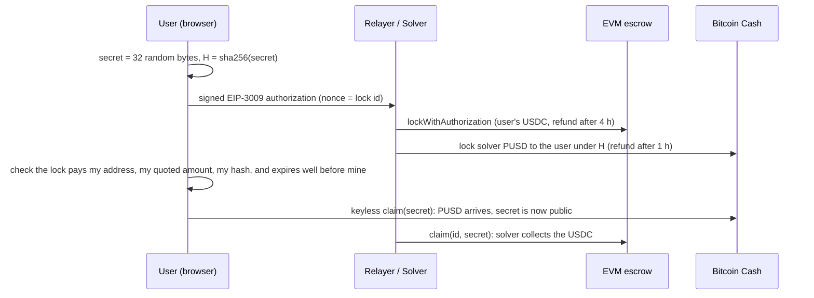
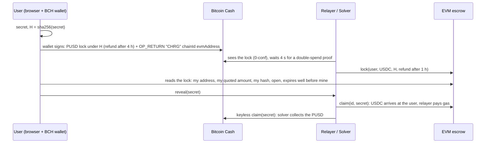

# Chirograph protocol

Chirograph swaps USDC on Base or Arbitrum for PUSD on Bitcoin Cash, and back, with a hash time-locked
atomic swap. Nothing is bridged or wrapped: USDC never leaves its EVM chain and PUSD never leaves Bitcoin
Cash. Each side locks its own funds to the same 32-byte secret, and revealing the secret on one chain is
exactly what lets the other side claim on the other chain.

A medieval chirograph was one deed written twice on one parchment and cut apart through a word. Each
party kept a half, and the halves only matched each other. Here the word is the secret.

## Parties

| Party | Role | Holds keys to |
|---|---|---|
| **User** | Wants to move between USDC and PUSD | Their BCH wallet (via WizardConnect), their EVM wallet, and the swap secret (generated in their browser) |
| **Solver** | Market maker with PUSD on BCH and USDC on EVM | Its own inventory only |
| **Relayer** | Submits user transactions on EVM and pays the gas | Nothing of the user's: it can delay a submission, never change one |
| **Anyone** | Can execute BCH claims and refunds (they are keyless) | Nothing |

In the reference deployment the solver and relayer are one service. The protocol does not need that.

## The two locks

### Bitcoin Cash: `ChirographLock` (CashScript 0.14, P2SH32)

Constructor: `secretHash, claimBytecode, refundBytecode, refundTime, maxFee`.

- `claim(secret)`: `secret` is exactly 32 bytes and `sha256(secret) == secretHash`.
- `refund()`: `tx.time >= refundTime` (a unix timestamp in `nLockTime`, checked by the network against
  median time past).
- Both paths call one shared payout rule, compiled into a reusable function with `OP_DEFINE` /
  `OP_INVOKE` from the May 2026 network upgrade. The output **at this input's own index** must:
  - pay exactly `claimBytecode` (or `refundBytecode`),
  - carry the same token category, token amount and NFT commitment as the input,
  - keep at least `input value - maxFee` satoshis.

There is no signature anywhere in the contract. The destination is fixed at lock time, so the user's
browser, the solver, a watchtower or a stranger can all execute a claim or refund, and none of them can
redirect a single token. The executor's only freedom is the miner fee, capped at `maxFee` (1,000 sats).
Checking the output at the input's own index lets several locks settle in one transaction without two
inputs sharing one payout. Compiled size: 72 bytes.

### EVM: `ChirographHTLC` (Solidity 0.8.28)

One deployment per chain, bound to native USDC. Ownerless, no admin functions, no upgrade path.

- `lock(recipient, amount, secretHash, refundTime)`: solver path, pulls USDC with `transferFrom`.
- `lockWithAuthorization(from, recipient, amount, secretHash, refundTime, validAfter, validBefore, signature)`:
  user path. The relayer submits the user's EIP-3009 `ReceiveWithAuthorization` and pays the gas. The
  authorization's nonce **is** the lock id, `keccak256(chainId, escrow, token, sender, recipient, amount,
  secretHash, refundTime)`, so the signature only works for this exact lock. Change any parameter and USDC
  rejects the signature.
- `claim(id, secret)`: anyone may call; pays `recipient`; emits the secret.
- `refund(id)`: anyone may call after `refundTime`; pays `sender`.

`sha256` is used on both chains, over the same 32 bytes, so one secret satisfies both locks.

## Flows

### USDC → PUSD

### PUSD → USDC

The OP_RETURN binds the EVM payout address to the user's own signed lock transaction, so nobody can open
the swap on the user's behalf with a different payout address. If the relayer does not claim, the
browser can claim directly with the user's EVM wallet; the checks are the same.

## Timeouts

The party that holds the secret locks first and gets the longer timeout. The counterparty's timeout is
shorter, so after the secret appears there is always time to reuse it before the first lock can refund.

| Direction | First lock (user) | Second lock (solver) |
|---|---|---|
| USDC → PUSD | EVM, 4 h | BCH, 1 h nominal |
| PUSD → USDC | BCH, 4 h nominal | EVM, 1 h |

Bitcoin Cash checks time locks against **median time past**, which trails the wall clock by about an hour
on 10-minute blocks. A BCH refund therefore opens later than its nominal time, which only ever helps the
counterparty. The margins account for it:

- The solver fixes its lock's refund time when it actually locks (not when the swap opens) and refuses
  to lock unless at least 2.5 h (USDC → PUSD) or 1.5 h (PUSD → USDC) separate its refund from the user's.
- The browser refuses to reveal if the solver's lock expires in less than 15 minutes, or less than an
  hour before the user's own lock.

From May 2027 Bitcoin Cash moves to one-minute blocks (CHIP-2025-03, locked in on 15 November 2026). Median
time past then trails by minutes instead of an hour, and the timeouts can shrink accordingly.

## Fast settlement: 0-conf with double-spend proofs

The solver accepts an unconfirmed BCH lock for PUSD → USDC swaps up to a cap (`INSTANT_MAX_CENTS`), after
a short window (4 s) in which no double-spend proof appeared. The risk sits with the solver: if the user
double-spends the lock after the solver locked USDC, the user could take both. The cap bounds that loss.
Larger swaps wait for one confirmation.

For USDC → PUSD the user's EVM lock confirms in about 2 s on Base, and the user claims the solver's BCH
lock straight from the mempool. The browser applies the same rule in reverse: it watches the solver's
unconfirmed lock for 1.5 s and refuses to reveal the secret if a double-spend proof appears. A solver that
double-spends its own lock after the user revealed could otherwise take both sides; the window, the small
amounts and the public solver identity bound that risk, and a user who wants none can wait for the lock
to confirm.

## Failure modes

| What goes wrong | What happens |
|---|---|
| Solver never locks | The user's lock refunds after its timeout. On BCH anyone can execute the refund; the solver's watchtower does it, and the app has a button. |
| User never reveals | The solver's lock refunds after its (shorter) timeout, then the user's. |
| Relayer goes offline mid-swap | Claims and refunds on BCH need no key; EVM claims and refunds are public functions. The browser can claim directly. |
| Solver lies about a lock | The browser checks every lock on-chain against what it asked for (address, amount, hash, timeout) and keeps the secret if anything differs. |
| Someone sends dust or junk to a lock address | Ignored: only the expected outpoint, token and amount count. |
| Retry or crash in the solver | Second-leg parameters are fixed and persisted before the first send; the exact signed transaction is re-sent, and identical EVM parameters give an identical lock id the contract refuses to open twice. Every (re)broadcast first re-checks that the user's lock is still open and that enough time is left. |
| A relayed user lock reverts | The solver reads the escrow: if the lock exists anyway it proceeds, otherwise the swap fails cleanly and frees its reserved inventory. |
| Someone opens many tiny swaps | A minimum swap size, a per-address rate limit, atomic inventory reservation, and a BCH fee reserve below which capacity drops to zero. |

## Honest limits

- **One solver today.** The reference solver is the only liquidity, and it holds a few dollars on purpose.
  The RFQ API is open, so anyone can run another, but nobody else does yet.
- **0-conf is a priced risk, not a guarantee.** The solver fills unconfirmed locks only in the instant
  tier, only when every input is P2PKH (double-spend proofs cannot cover anything else), only when the
  proof server answered, one swap per lock transaction, and under a cap on total unconfirmed exposure.
  The user side mirrors it: above a threshold, or without a proof answer, the browser waits for a
  confirmation before claiming.
- **Timing margins assume median time past trails by about an hour.** It can trail by less; the margins
  are sized so that even a 20-minute lag leaves the counterparty more than an hour to reuse the secret.
- **The quote is checked, not trusted.** The app pins the maximum fee and the escrow, USDC and token
  addresses; a quote or solver that disagrees is rejected before anything is signed.
- **The relayer sees the secret before the chain does** for PUSD → USDC (it submits the claim). The claim
  pays the user no matter who submits it, but a dishonest relayer could sit on it. The browser therefore
  only reveals while the solver's USDC lock has at least 45 minutes left, then watches the escrow itself
  and claims with the user's own wallet if the relayer has not within 30 seconds. Once the secret is out
  the solver never refunds that lock; it claims it for the user.
- **Free option.** A user can sign, wait, and reveal only if prices moved in their favour. For a
  stablecoin pair the option is worth little, and the solver's timeout limits it to an hour.
- **WizardConnect has no message signing**, so there is no "sign in with wallet"; the wallet's derived
  address is the identity.
